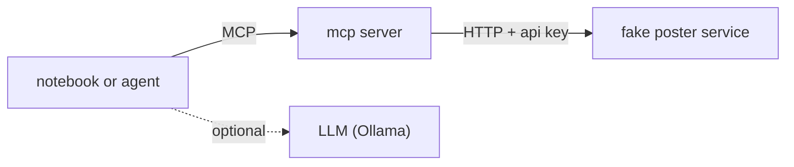
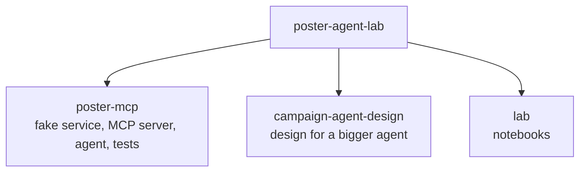

# poster-agent-lab

A small experiment with MCP. There's a fake poster-generation service, an MCP server in front of it, and a tiny agent that uses the tools. The interesting part is what happens when things go wrong: slow jobs, random failures, retries, bad input.

Everything runs in Docker, and there's a JupyterLab with notebooks to poke at it.



## run it

```bash
docker compose up --build
```

Then open http://localhost:8888. It opens the first notebook. Stop with `docker compose down`.

| | |
|---|---|
| http://localhost:8888 | JupyterLab with the notebooks |
| http://localhost:8001/mcp | the MCP server, any MCP client can connect |
| http://localhost:8000/docs | the fake poster service |

No setup needed. To let the agent notebook use a real model, put `OLLAMA_API_KEY=...` in a `.env` file next to `docker-compose.yml` (see `.env.example`). Without it a scripted fake model is used, which runs the same loop and checks.

## what's in here



- [`poster-mcp`](poster-mcp): the code, with its architecture diagrams in the README. There's also a [recorded agent run](poster-mcp/docs/transcript.md) and some [design notes](poster-mcp/docs/design-notes.md).
- [`campaign-agent-design`](campaign-agent-design): a design (no code) for an agent that runs a whole campaign across posters, screens and email, with a person approving anything irreversible.
- [`lab`](lab): the notebooks. Its README has a table of what each file does.

## notes

- All three ports are published on every network interface, so you can reach them from another machine at `http://<host>:8888` and so on. JupyterLab gives a root shell in its container, and by default it has no login. If anyone else can reach the machine, set `JUPYTER_TOKEN` in `.env` and open `http://<host>:8888/?token=<token>`.
- When browsing from another machine, also set `PUBLIC_HOST=<host>` in `.env`. Otherwise the poster image links in notebook 01 point at `localhost` and won't load.
- The fake service speeds jobs up (`MOCK_TIME_SCALE=0.3`). Set it to `1` for the real 5 to 20 seconds.
- To run the tests: `docker compose exec jupyter sh -c "cd /app/poster-mcp && python -m pytest -q"`.
- Without Docker, see [`poster-mcp/README.md`](poster-mcp/README.md).
