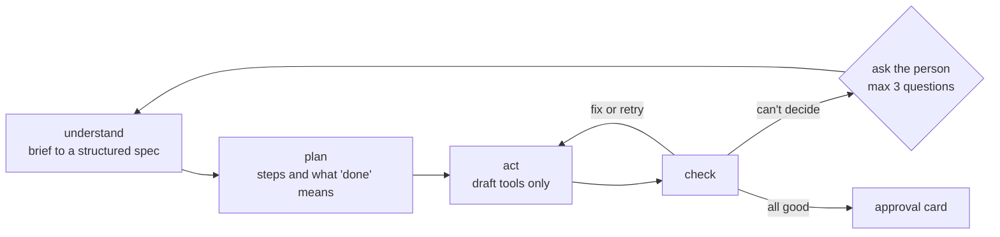

# the loop

One orchestrator agent, not several. The steps depend on each other (screens and email need the finished poster urls), the context is small, and one trace is much easier to follow than hand-offs between agents. Small helpers, like an Arabic copy proofreader, are plain model calls and not agents.

- Checks are done by code first: job completed, days and hours match the spec in local time, the segment isn't empty, the email isn't blank. A model only judges what code can't, like whether a poster fits the brand.
- Waiting on a poster job is done by the harness, not the model. It polls, and wakes the model when the job is done, so waiting costs no tokens.
- Independent steps run in parallel, for example poster jobs and building the audience segment.

[back to the overview](README.md)
