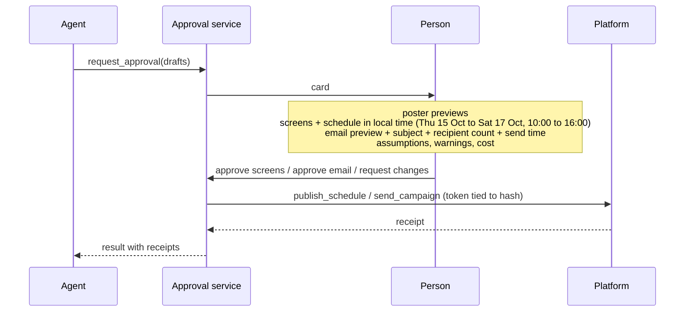

# approval

One card, and screens and email are approved separately, because an email can't be unsent.

The card also has a "send me a test" button, run by the platform. An unusually large audience needs a second confirmation. Only people with publish permission can approve.

[back to the overview](README.md)
