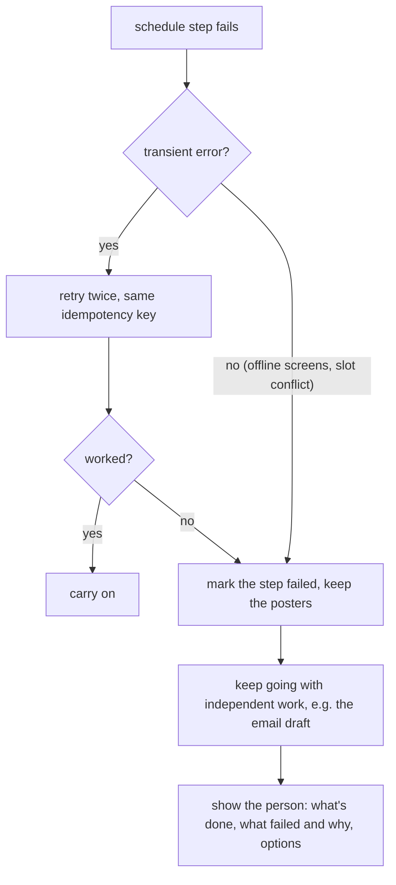

# when things fail

**Posters are ready but scheduling fails.** The posters are saved, so they're never regenerated, since that costs money.

The agent never says "scheduled" unless a tool receipt says so.

**A tool times out.** Reads and idempotent creates are retried with backoff. If the outcome of a create is unknown, the agent first looks it up by idempotency key before retrying. After the retry budget the step is marked blocked and the task is suspended, not killed.

**The brief is ambiguous.** It asks when a wrong guess is costly, hard to undo, or can't be known:

- which audience, if several segments could be "loyalty customers"
- which week "Thursday" means, and which screen groups
- offer details. It never invents prices or discounts.
- missing product or brand images, or contradictions like a send time in the past

It decides on its own, and lists as assumptions on the card: timezone (Asia/Riyadh by default), number of variants (3 at 1k), template, wording, sequence order and durations, dialect (from the brand profile), subject line.

[back to the overview](README.md)
