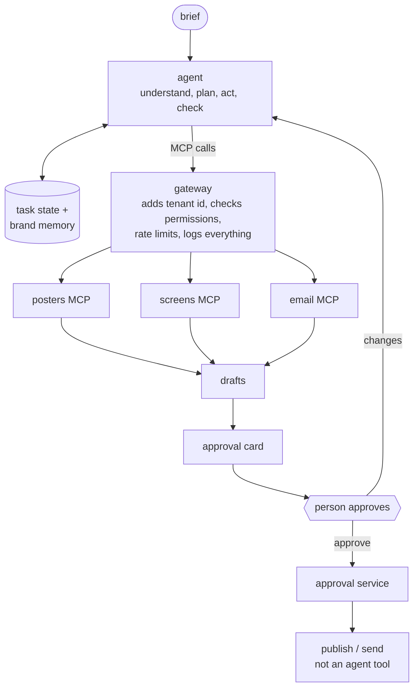

# campaign-agent-design

An agent that takes a plain-language brief and prepares a campaign across three products: poster generation, in-store screens and email.

> "Run a weekend sale for our coffee-shop chain. Make Arabic posters, show them on our in-store screens Thursday to Saturday from 10:00 to 16:00, and email our loyalty customers on Thursday at 9:00."

The agent prepares drafts. A person approves. The platform publishes and sends. It's a design only, there's no code for it. The poster tools it would use are the ones in [`poster-mcp`](../poster-mcp).

There's also a condensed Word version, [campaign-agent-design.docx](campaign-agent-design.docx): 3 pages, one diagram, same content.

## the two rules, and how they're enforced

Both are enforced by the structure, not by telling the model to behave.

- **Nothing goes out without approval.** The agent only has draft tools. `publish_schedule` and `send_campaign` aren't in its toolset. The approval service calls them after a click, with a token tied to a hash of what the person saw. If anything changes after that, the token is void.
- **Never touch another customer's data.** The model has no tenant argument anywhere. The gateway adds the tenant id from the logged-in session, and every backend checks it again. Other tenants' ids look like "not found". Email recipients are only reachable through a segment id the tenant owns, and the agent only ever sees counts, never addresses.

## read more

- [01-loop.md](01-loop.md): How the agent plans, acts and checks its work, and why it is one agent.
- [02-tools.md](02-tools.md): The 14 tools, and which few are shown at a time.
- [03-memory.md](03-memory.md): What the agent remembers during a task and across tasks.
- [04-approval.md](04-approval.md): What a person sees and approves before anything goes out.
- [05-failures.md](05-failures.md): Partial failures, timeouts, and ambiguous briefs.
- [06-cost-and-speed.md](06-cost-and-speed.md): Limits, which model does what, and where time goes.
- [07-observability.md](07-observability.md): What gets logged so a person can see why the agent did something.
