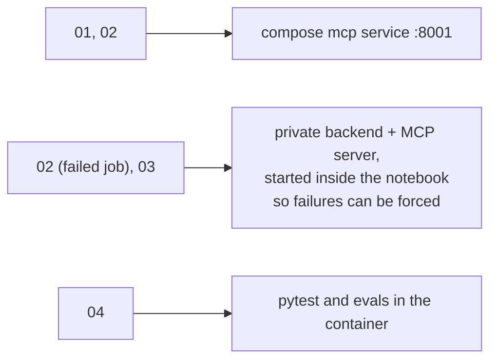

# lab

Notebooks for trying the MCP server by hand. They run inside the `jupyter` container, which `docker compose up --build` starts at http://localhost:8888. The folder is mounted, so edits and re-runs are saved here. Saved outputs come from a real run, so you can read them without running anything.

| file | what it does | uses |
|---|---|---|
| `01_mcp_tour.ipynb` | lists the tools and their schemas, lists templates, makes a poster job, polls it, shows the posters, cancels a job | the compose `mcp` service |
| `02_failures_and_safety.ipynb` | bad input errors, idempotent retries, the active-job cap, then a forced failed job and its recovery, and a check that the api key never leaks | the compose `mcp` service, and a private stack for the last part |
| `03_agent_demo.ipynb` | an LLM agent making posters from a brief (first job forced to fail), then the six evals | a private stack. A real model if `OLLAMA_API_KEY` is set, a scripted fake otherwise |
| `04_tests_and_evals.ipynb` | runs the 26 pytest tests and the scripted evals | nothing else |
| `demoUtils.py` | small helpers the notebooks import: `connectMcp`, `callTool`, `show`, `waitForJob`, `showImages` | |

Run them in order, starting with `01_mcp_tour`, which is what opens at http://localhost:8888.

Good to know:

- Jobs are sped up (`MOCK_TIME_SCALE=0.3`). Set it to `1` in `docker-compose.yml` for the real 5 to 20 seconds.
- Notebook 03 uses a real model if `OLLAMA_API_KEY` is set (in a `.env` file next to `docker-compose.yml`), and a scripted fake otherwise. Both run the same loop and checks.
- The code is in `/app/poster-mcp` inside the container (`../poster-mcp` in this repo). **File > New > Terminal** in JupyterLab gives you a shell there.
