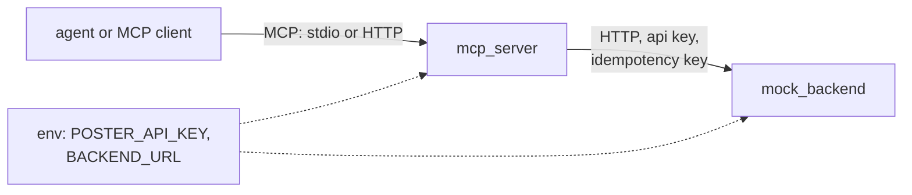
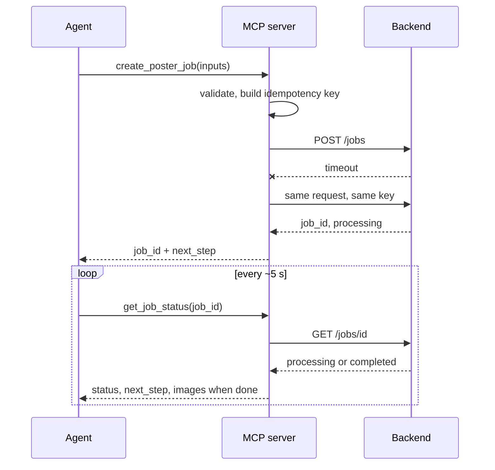
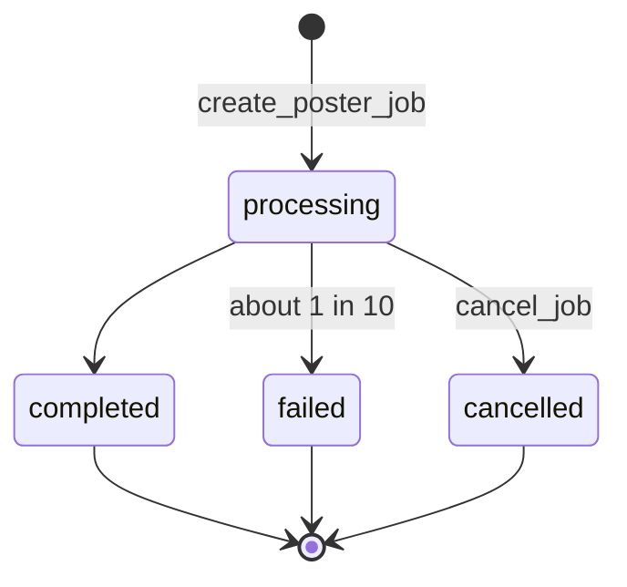
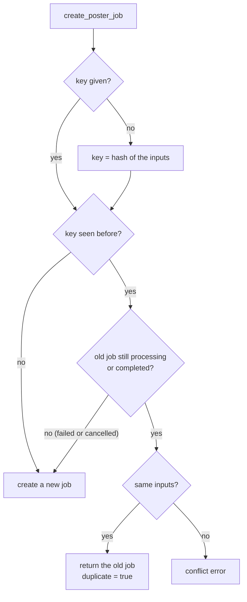
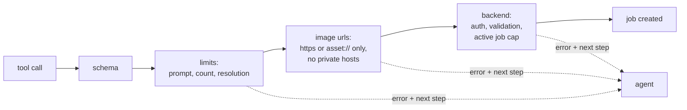
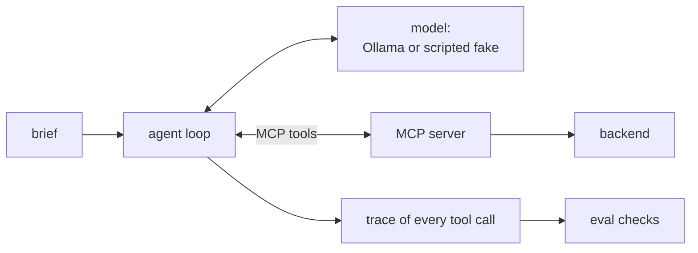
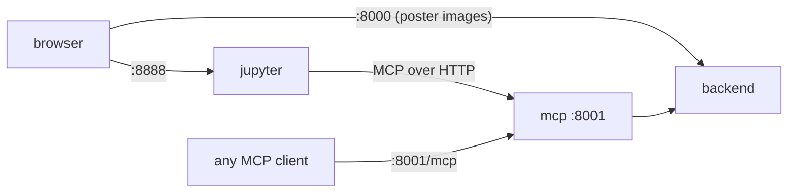

# poster-mcp

An MCP server that lets an agent use a poster-generation service, a fake version of that service to run it against, a small agent loop, and tests.

An agent talks MCP to the server, and the server talks HTTP to the poster service. The real service doesn't exist here, so `mock_backend` plays its part, including the bad behaviour: slow jobs, random failures, validation errors.



## the tools

- `list_templates(category?, search?)`
- `create_poster_job(product_image, background_image, prompt, template_id?, image_count=1, resolution="1k", idempotency_key?)`
- `get_job_status(job_id)`
- `cancel_job(job_id)`

Creating a poster is async, so `create_poster_job` returns a job id and you poll `get_job_status`.

## run it

With Docker, from the repo root: `docker compose up --build`. That starts this plus the notebooks, see the [root README](../README.md).

Without Docker you need Python 3.11+ and [uv](https://docs.astral.sh/uv/):

```bash
uv sync
uv run pytest                 # 26 tests
uv run python -m agent.evals  # agent evals with the scripted model
```

To run the servers:

```bash
export POSTER_API_KEY=dev-key
uv run uvicorn mock_backend.app:createApp --factory --port 8000   # terminal 1
uv run python -m mcp_server                                        # terminal 2 (stdio)
```

Connecting a client that spawns the server itself:

```json
{
  "mcpServers": {
    "poster-service": {
      "command": "uv",
      "args": ["run", "--directory", "/path/to/poster-mcp", "python", "-m", "mcp_server"],
      "env": { "POSTER_API_KEY": "dev-key", "BACKEND_URL": "http://localhost:8000" }
    }
  }
}
```

For HTTP instead of stdio: `python -m mcp_server --transport streamable-http --port 8001`.

## settings

| variable | default | |
|---|---|---|
| `POSTER_API_KEY` | required | shared secret between the MCP server and the service |
| `BACKEND_URL` | `http://localhost:8000` | where the service is |
| `MOCK_TIME_SCALE` | `1` | `0.1` makes jobs ten times faster |
| `MOCK_FAIL_RATE` | `0.1` | chance a job fails |
| `MOCK_FAIL_FIRST_N` | `0` | force the first N jobs to fail |
| `OLLAMA_API_KEY` | none | only for running the agent with a real model |

## how it works

### one request

A create call that times out once and gets retried. The retry is safe because of the idempotency key.



### job states

The backend has no background threads. A job remembers when it started, how long it takes and whether it will fail, and its status is worked out from the clock when someone asks. That's why the tests can use a fake clock instead of sleeping.



### idempotency

If a request times out the agent can't know whether the job was created, so it retries. This is what the backend does with that retry.



To deliberately get a second batch with the same inputs, pass a new key.

### what a create call goes through

Every failure comes back as plain text: what went wrong, then `Next step: ...`. The hints live in one dictionary, `errorHints` in `mcp_server/server.py`.



The MCP server checks first so mistakes are caught quickly with good messages. The backend checks again because it's the real gatekeeper.

Other things worth knowing:

- Network errors and 5xx are retried 3 times. If the service stays down, the error tells the agent to retry with the same key.
- A job running longer than 60 s gets a warning telling the agent to cancel it and start a new one.
- The api key is read from the environment, sent only as an `Authorization` header, scrubbed from error text and never logged. A test checks this.
- Image links are signed and expire after 15 minutes. Calling `get_job_status` again gives fresh ones.

### the agent

`agent/` has a small tool-calling loop, two model backends (a real one on Ollama and a scripted fake) and six eval cases.



The loop sends the brief and the tool list to the model, runs the tool calls it asks for, feeds results back, and stops after 20 steps. It waits for `retry_after_seconds` between polls.

The scripted model follows one fixed policy. It's free and repeatable, so it tests the tools, loop and checks. Only a real model tells you how well an LLM actually uses the descriptions and errors.

The six evals check what the agent did and said, not its exact words: happy path, recovering from a failed job, not claiming success when every job fails, respecting the 4 image limit, cancelling on request, and shortening a too-long prompt.

```bash
uv run python -m agent.run --fail-first 1   # one brief, first job fails, agent retries
uv run python -m agent.evals --live         # evals with a real model, needs OLLAMA_API_KEY
```

A recorded run is in [docs/transcript.md](docs/transcript.md). Real models vary from run to run. For example `nemotron-3-nano:30b` sometimes polls many times before cancelling a job when asked to cancel right away, so the cancel eval uses a job that can't finish during the test.

### in docker



## choices

- Create and status are separate tools because jobs are async. The cost is polling. For jobs that take minutes you'd want push notifications. More in [docs/design-notes.md](docs/design-notes.md).
- Images come back as links. Image data would eat thousands of tokens each.
- If no idempotency key is given, one is built from the inputs. An identical repeat is then deduplicated even if the agent forgot.
- `mcp` is pinned to 1.x because the 2.x SDK renames a lot of the API.

## limits

- Single tenant. In a real system the tenant would come from the credential, never from a tool argument.
- The image url check doesn't resolve DNS. A real backend must also block private addresses when it fetches images.
- Jobs live in memory and are lost on restart. Images are SVG placeholders.
- Both images and the prompt are required, and the defaults are 1 image at 1k.

## layout

```
mock_backend/   the fake poster service (FastAPI)
mcp_server/     the MCP server
agent/          agent loop, models, evals
tests/          pytest
docs/           design notes, transcript
```
